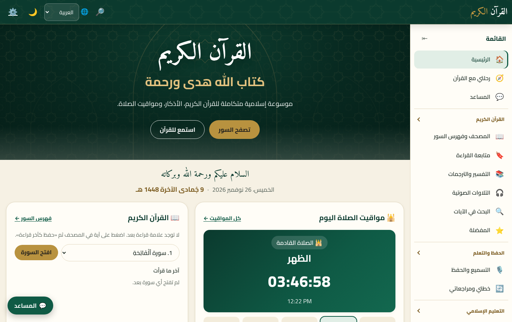
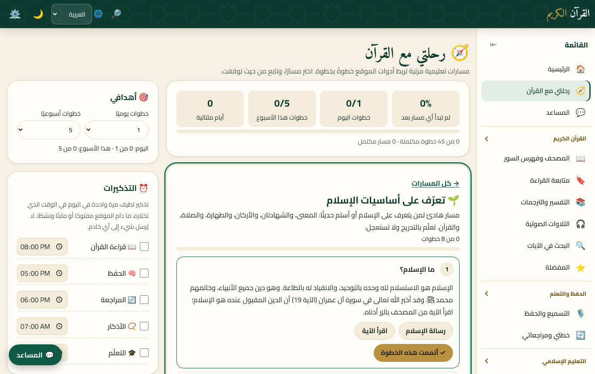
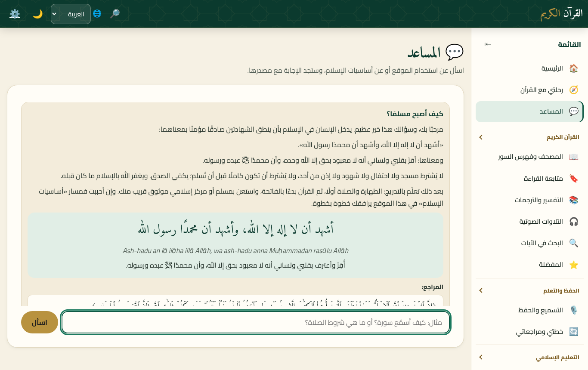
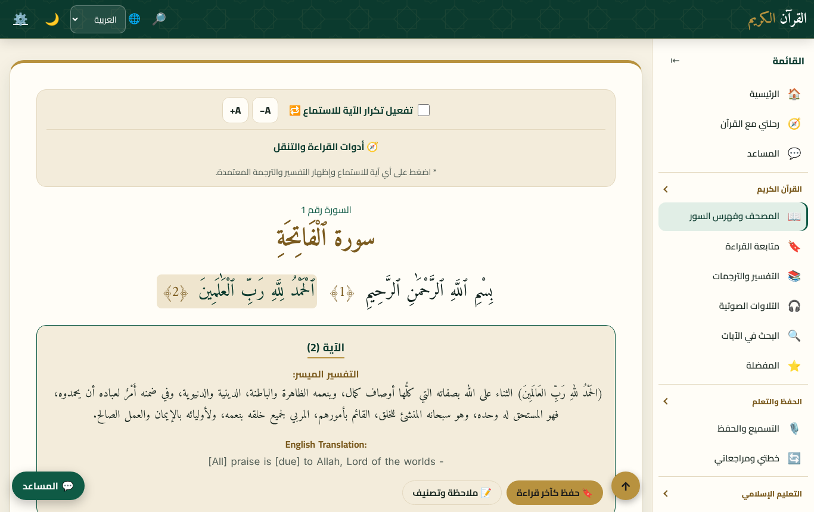
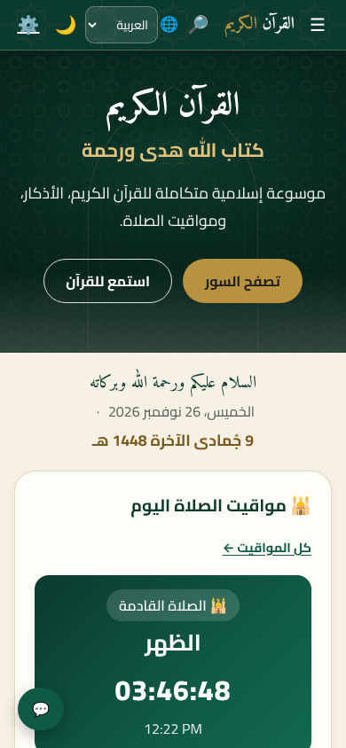
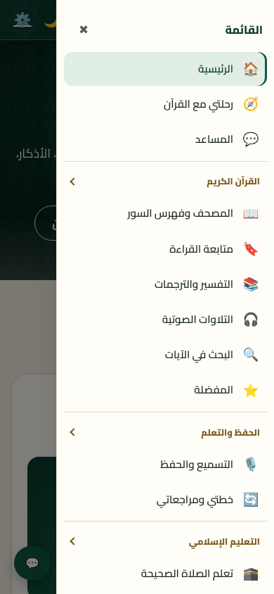

# Platform transformation (2026-11-26)

Sidebar + multi-page navigation, a new home dashboard, the **Quran Journey** (رحلتي مع القرآن) and a
conversational **assistant**. No existing feature was removed; every feature has a place in the sidebar.

## 1. Audit summary (baseline before any change)

* Branch base: `main` at `f95709a` ("Revert PR #7: restore assistant to pre-AI version").
* Architecture: static site on GitHub Pages (index.html + native ES modules, no build step), optional FastAPI
  backend, service worker with precached shell, user data in `localStorage` only.
* Baseline tests: **56/56** Node unit, **124/126** Playwright e2e (the 2 skipped need the live site), backend pytest
  untouched by this work.
* Problem: one very long page (hero, stats, dashboard, tool grid, journey, insights, prayer, academy, prayer course,
  surahs, player, reader) plus 9 top-nav entries and a 9-entry drawer: crowded and hard to scan.

## 2. Feature inventory and new location

| Feature (module) | Was | Now (route) | Changes |
|---|---|---|---|
| Hero, greeting | top of the single page | Home `#/` (compact) | dates + greeting added |
| Stats strip | under hero | Quran page | moved |
| Next prayer + countdown (`prayer.js`) | dashboard | Home (prayer card) | + compact list of 5 prayers |
| Prayer times, Hijri, location (`prayer.js`) | section | `#/prayer` | + notify buttons, method note |
| Prayer notifications (`prayer.js`, settings) | settings/profile | Home, `#/prayer`, `#/settings` | same code, more entry points |
| Daily wird (`wird.js`) | dashboard | `#/progress` | moved |
| Daily journey cards (`dashboard.js`) | dashboard | `#/progress` | moved |
| Insights «بصيرة», khatma planner (`insights.js`) | dashboard | `#/progress` | moved |
| Daily companion (verse, dhikr, lesson, goal, question of the day) | dashboard | Home (daily content) | moved |
| Tool grid (favourites, search, profile, settings, assistant, notes) | dashboard | sidebar entries | grid removed, every tool kept |
| Surah index, filter, favourites toggle (`surahs.js`) | section | `#/quran` | — |
| Reader: tafsir, translation, juz/page, themes, range repeat, bookmark (`reader.js`) | section | `#/quran`, `#/quran/<n>`, `#/read` | + `details` option (tafsir without audio) |
| Tafsir & translations | inside reader | `#/tafsir` (guide + open-with-tafsir) | new small page, reader unchanged |
| Audio player, 16 reciters, speed, sleep timer, queue, download (`player.js`) | section | `#/audio`; mini player everywhere | — |
| Ayah search (`ayah-search.js`) | dialog | dialog, from sidebar | — |
| Islamic search (`islamic-search.js`) | dialog | dialog, header 🔎 + sidebar | — |
| Memorisation lab, mic test, modes, plan, revisions (`voice-lab.js`, `memorization.js`) | dialog | `#/memorize`, `#/memorize/plan` | shown as a page |
| Prayer curriculum (18 lessons, tutorial, scholars, verify tools) (`learn.js`) | inside academy section | `#/learn-prayer`, `#/learn-prayer/wudu` | own page; academy links to it |
| Academy courses (`learn.js`) | section | `#/academy` | — |
| Lesson & course dialogs | dialogs | dialogs (unchanged) | — |
| «رسالة الإسلام» | dialog | `#/islam` | shown as a page |
| Hisn al-Muslim + rosary tab (`adhkar.js`, `rosary.js`) | dialog | `#/adhkar`, `#/adhkar/<tab>`, `#/tasbih` | shown as a page |
| Favourites (`favorites.js`) | dialog | `#/favorites` | page |
| Notes & collections (`notes.js`) | dialog | `#/notes` | page |
| Profile + backup/restore (`profile.js`, `backup-panel.js`) | dialog | `#/profile` | page |
| Settings (`settings-panel.js`) | dialog | `#/settings` | page |
| Assistant (`assistant.js`) | dialog + floating button | `#/assistant` + floating button | rebuilt engine (see §5) |
| Login / donate / contact | dialogs | dialogs, sidebar → «المزيد» | — |
| «من أنا» (`about.html`) | separate page | separate page, sidebar → «المزيد» | — |
| Theme, language | header | header | — |
| PWA, service worker, offline | — | — | SW `v4.0.0`, new files precached |

Old anchors (`#surahs`, `#audio`, `#prayerSection`, `#learnSection`, `#academySection`, `#dashboardSection`, …) and
old dialog ids (`data-open="adhkarModal"`, `rosaryModal`, `sideMenu`, …) still work.

## 3. Architecture

* **Pages** are `<section class="page" data-page="…">` inside `index.html`; `core/routes.js` (pure, tested) parses
  `#/page/param`; `core/router.js` shows one page, handles back/forward/refresh, legacy anchors and route actions.
  One HTML file keeps GitHub Pages, the CSP, the service worker and every module unchanged — no server or build step.
* **Dialogs as pages**: dialogs marked `data-page-dialog` live inside their page and are shown non-modally while it is
  visible (`core/modal.js`). `openDialog(id)` navigates there, so every existing opener works; leaving the page closes
  the dialog, so existing close behaviour (e.g. the lab releasing the microphone) is unchanged.
* **Reveal**: `scrollIntoViewSmart()` first reveals the page holding the target (`dom.js` → router), so `readSurah()`
  from any page opens the reader page and records it in history.
* **Sidebar** (`features/sidebar.js`): groups (persisted), collapse to icons (persisted), off-canvas below 1024 px with
  backdrop, Escape, inert background and focus return; active link has `aria-current="page"`.
* **Storage**: four new keys only — `sidebarState`, `quranJourney`, `journeyReminders`, `recentSurahs` (included in
  backups automatically). No existing key changed.

## 4. Quran Journey

`data/journey-paths.js` (content), `core/journey.js` (progress, pure), `core/reminders.js` (pure),
`features/journey.js` (UI). Six paths: learn to read (letters, vowel marks, quiz, listen-and-follow, tajweed intro,
short surahs, lab assessment), memorise, improve recitation, understand (tafsir, translations, reflections, search),
wudu & prayer, basics of Islam (welcoming, with the Shahada). Steps open existing tools; steps tied to existing
activity complete automatically from that activity's own data (lessons, memorisation store, notes, reading log,
listening log). Overall/path progress, daily and weekly goals, streak, 8 achievements, history (100 events),
pause/resume/start over, resume at the first unfinished step, home-page card. Reminders: off by default, one per type
per day, only within 90 minutes after the chosen time, via the service worker notification if allowed, else an in-page
notice.

## 5. Assistant

`core/conversation.js` (engine, pure and deterministic), `data/assistant-kb.js` (139 website questions in 23
categories), `data/islamic-kb.js` (46 entries: foundations, Quran, seerah, worship, ethics, common questions,
embracing Islam). Order: small talk → knowledge bases (with follow-up context: «كيف أقرأ القرآن؟» → «وكيف أستمع إليه؟» →
«وكيف أحفظه؟») → the original help topics / verified-passage search / Quran word search. Quran references are shown
from the verified dataset with a button to open them; hadith are cited by collection and number; entries carry a level
(agreed / difference / guidance); a ruling notice and "not a fatwa" note are shown where relevant. The embracing-Islam
answers are in Arabic, English, Spanish and French. No AI model, no network request for answers, output via
`textContent` only. The full question list is in [assistant_questions.md](assistant_questions.md).

## 6. Tests

* Full suite result (2026-11-26): **68/68 unit, 134 passed / 0 failed / 2 skipped (live-site) e2e.**
* Unit: 68 (56 existing + 12 new in `tests/unit/platform.test.mjs`): routes, page/dialog structure, ≥120 distinct
  questions, every question answered by its own entry (185 × 2 languages), small talk in 4 languages, follow-up
  context, adversarial input, Islamic references format, journey progress/storage repair, reminders.
  These test the assistant's own deterministic logic; no external AI is involved or claimed.
* End-to-end: existing Playwright suite updated where the navigation structure changed by design (top nav → sidebar,
  dialogs → pages, tool grid → sidebar), plus new navigation/journey/assistant tests in `tests/e2e/platform.test.mjs`.
  External APIs are mocked from the verified datasets (as before), so these do not prove the live upstream services.

## 7. Known limitations

* Arabic-letter pronunciation has no audio (no verified per-letter recordings in the project); the step points to a
  qualified reciter instead.
* Knowledge-base answers for Spanish and French visitors are shown in English (except the embracing-Islam entries).
* The recitation lab checks words, not tajweed; it needs a browser with speech recognition.
* Reminders and prayer alerts only fire while the site is open or installed and active (no push server, by design).
* The assistant matches keywords; unusual phrasings may fall back to the general content search.
* Islamic content was written carefully with references but should be reviewed by a qualified scholar before wide
  promotion.

## 8. Screenshots

| Home (desktop) | Quran Journey | Assistant |
|---|---|---|
|  |  |  |

| Reader with tafsir | Home (phone) | Menu (phone) |
|---|---|---|
|  |  |  |
